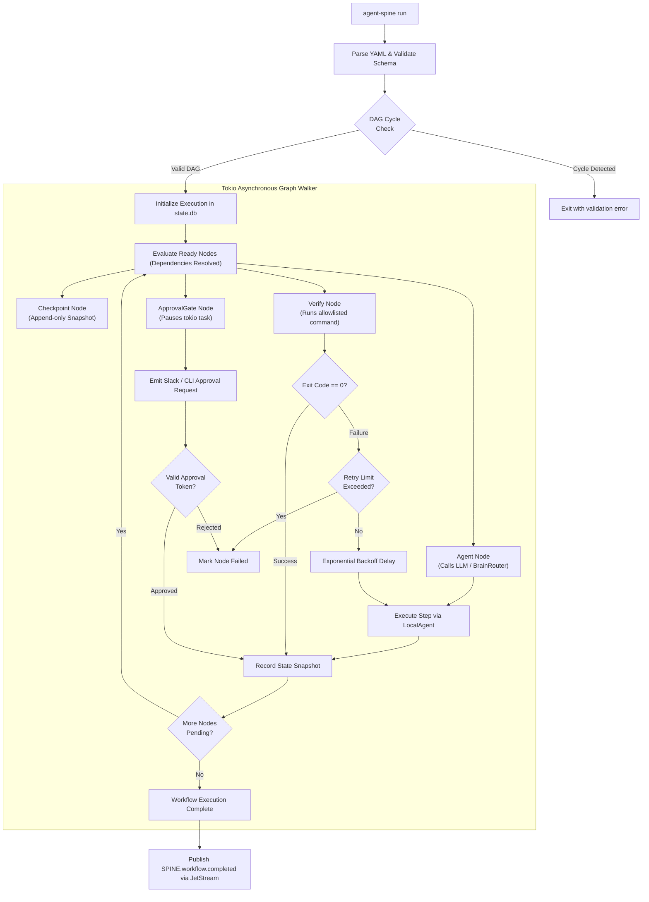

# agent-spine — Deep Operational & Architectural Context for Agents

> **Deterministic Workflow DAG Engine & State Machine** — In-depth architectural guide, execution lifecycle, node taxonomy, complete CLI matrix, MCP tool contracts, and failure recovery runbooks for `agent-spine`.  
> **Ecosystem Version Baseline:** `v1.0.0-rc3`  
> **Documentation Hub:** [https://autonomic-ai.dev/docs/workflows](https://autonomic-ai.dev/docs/workflows) · [Architecture Hub](https://autonomic-ai.dev/docs/architecture)  
> **Ports:** dashboard API `:3000` · dashboard `:3001` · event bus `:3100`  
> **Default Workspace & State:** `~/.autonomic/state/spine` (workflows) · `~/.autonomic/logs/spine/state.db` (run state)

---

## 1. Executive Summary & Biological Role

**`agent-spine`** is the **Deterministic Workflow Engine** (analogous to Kubernetes Jobs, Argo Workflows, or Temporal). 

Most AI coding agents fail because they rely on unconstrained, probabilistic prompt loops:
- The agent is asked *"fix bug X"*, and it improvises an unpredictable series of file reads, edits, and terminal commands.
- If step 4 fails, the agent often enters an hallucinatory retry loop, burns hundreds of dollars in tokens, or destroys working code.
- There is no audit trail, no deterministic replay, no coordinated parallelism, and no verifiable human approval gate.

`agent-spine` replaces ad-hoc prompt improvisation with **version-controlled, declarative Directed Acyclic Graphs (DAGs)** written in YAML:
- The graph dictates the control flow, concurrency, checkpoints, and gates.
- The LLM acts strictly as a bounded worker executing isolated tasks *within* designated nodes.
- Every state change is appended as a snapshot in SQLite, so a finished run can be inspected and replayed with `agent-spine replay`.

---

## 2. Core Architecture & Node Taxonomy



### 2.1 The Four First-Class Node Kinds (`NodeKind`)

1. **`Agent`**: Represents an isolated cognitive subtask. The step defines input variables, expected output keys, and optional prompt instructions. The executor hydrates required context via `BrainRouter` (querying `agent-brain`), runs the subtask, and collects outputs.
2. **`Checkpoint`**: An explicit synchronization barrier that captures an immutable state snapshot (`Snapshot`) of the workflow state at that point.
3. **`Verify`**: Executes an allowlisted validation command (e.g. `cargo check`, `npm test`, `pytest`). Must return exit code 0 to transition to subsequent nodes.4. **`ApprovalGate`**: A Human-in-the-Loop (HITL) safety barrier. When the execution reaches this node, the `tokio` worker suspends execution, enters the `PendingApproval` state, and emits events on the NATS bus when one is configured. A gate auto-approves unless auto-approval is turned off. When it is off, the node waits until its payload carries `approved: true`. No CLI command sets that flag.

---

## 3. Concurrency, Retries & Snapshot Invariants

### 3.1 Fan-Out / Fan-In Parallelism
`agent-spine` supports declarative parallel execution:
- Nodes with multiple outgoing edges fan out concurrently using `tokio::task::JoinSet`.
- Downstream *Join* nodes automatically pause until all incoming prerequisite edges resolve successfully.

### 3.2 Bounded Exponential Retries
To prevent recursive hallucinatory loops, each node configuration supports an explicit retry block:
```yaml
retry:
  max_attempts: 3
  initial_delay_ms: 1000
  backoff_multiplier: 2.0
  max_delay_ms: 10000
```
If `max_attempts` is exceeded, the node halts, records failure diagnostics, and either aborts the graph or triggers an alternate fallback path if defined in the YAML.

### 3.3 Immutable State Snapshots (Time-Travel Debugging)
Every successful node transition creates an append-only entry in `state.db`. If an agent makes a mistake on step 6:
- The developer can inspect the run with `agent-spine inspect <EXECUTION_ID>` and recreate its final state with `agent-spine replay <EXECUTION_ID>`.
- Snapshots are appended in order; the snapshot table is not updated in place.

---

## 4. Complete CLI Command Reference & Flags

`agent-spine` provides a unified binary for CLI execution, schema validation, template scaffolding, and daemon service:

### 4.1 Workflow Execution & Lifecycle
- `agent-spine run <WORKFLOW.yaml>`: Execute a workflow definition synchronously.
  - `-p, --payload <JSON>`: Initial JSON payload.
  - `-m, --meta <TEXT>`: Use agent-brain to select the workflow from this task prompt before execution.
  - `-b, --brain`: Enable agent-brain routing and enrichment.
  - `-d, --db <PATH>`: SQLite state database (default: `~/.autonomic/logs/spine/state.db`).
- `agent-spine validate <WORKFLOW.yaml>`: Validate DAG syntax, node types, and acyclicity.
- `agent-spine inspect <EXECUTION_ID>`: Show the history of one execution.
- `agent-spine replay <EXECUTION_ID>`: Recreate an execution's final state.
- `agent-spine status`: Show the capabilities planned for the current scaffold.

### 4.2 Human-in-the-Loop Approval Gates
There are no `approve` or `reject` commands. Gates auto-approve unless auto-approval is turned off; see the `ApprovalGate` node description above for the `approved: true` payload rule.

### 4.3 Template Scaffolding & Registry
- `agent-spine init`: Scaffold an example workflow and check the environment.
  - `-f, --force`: Skip prerequisite checks (protoc, bun, agent-brain).
  - `-d, --dir <DIR>`: Target directory (default: `~/.autonomic/state/spine`).
  - `-w, --with <WORKFLOW>`: Scaffold a built-in workflow instead of the generic example. `--with list` shows the built-in workflows (for example `engineering-safety`, `feature-from-spec`, `system-architect`) and the agent-brain registry workflows (for example `@bugfix`, `@feature`).

### 4.4 Daemon & Server Modes
- `agent-spine serve`: Start the live dashboard API.
  - `-p, --port <PORT>`: API port (default: `3000`).
  - `--dashboard-port <PORT>`: Dashboard port (default: `3001`).
  - `--nats-url <URL>`: Optional NATS JetStream URL for event publishing.
- `agent-spine event serve`: Start the event bus server (default port `3100`).
- `agent-spine mcp-serve`: Start standalone stdio MCP server exposing workflow orchestration tools directly to an IDE or any MCP host.

### 4.5 Diagnostics & Brain Integration
- `agent-spine doctor`: Check rustc, protoc, bun, the `agent-brain` binary, the spine state directory and the example workflow.
- `agent-spine brain health`: Check whether agent-brain is reachable.
- `agent-spine brain route <TASK>`: Send a `route_task` query to agent-brain and show the response.
- `agent-spine brain status`: Show agent-brain index and status information.

---

## 5. Model Context Protocol (MCP) Tool Specifications

When running in MCP mode (`agent-spine mcp-serve`), the following tools are exposed:

### 5.1 `spine_submit_workflow`
- **Description:** Submits a YAML workflow for execution and returns its workflow ID.
- **Parameters:**
  - `yaml` (string, required): Inline YAML content of the workflow definition.
  - `name` (string, optional): Name for the workflow run.
- **Return:** The workflow ID, as text.

### 5.2 `spine_workflow_status`
- **Description:** Queries the current execution state, active steps, outputs, and snapshots of a workflow.
- **Parameters:**
  - `workflow_id` (string, required): The target execution ID.
- **Return:** The execution's current status, as text.

---

## 6. Declarative Workflow YAML Specification

Below is an authentic, production-grade example of a workflow definition (`bugfix-pipeline.yaml`):

```yaml
version: 1
name: bugfix_pipeline
description: "Reproduce, isolate, fix, and verify a bug with human sign-off"

inputs:
  issue_id:
    type: string
    description: "Issue or bug ticket identifier"
  test_command:
    type: string
    default: "cargo test"

nodes:
  - id: reproduce_failure
    kind: Verify
    command: "${test_command}"
    description: "Run test suite to verify reproduction of bug"
    continue_on_failure: true

  - id: isolate_and_patch
    kind: Agent
    depends_on: [reproduce_failure]
    prompt: "Analyze test failure in issue ${issue_id}, isolate root cause, and apply minimal patch"
    retry:
      max_attempts: 2
      initial_delay_ms: 1000

  - id: verify_fix
    kind: Verify
    depends_on: [isolate_and_patch]
    command: "${test_command}"
    description: "Confirm all tests pass cleanly after patch"

  - id: human_review
    kind: ApprovalGate
    depends_on: [verify_fix]
    description: "Review git diff and test verification output before final commit"
    timeout_secs: 3600

  - id: commit_and_log
    kind: Agent
    depends_on: [human_review]
    prompt: "Commit changes using conventional commit message and record verification outcome"
```

---

## 7. Cluster Operations & Troubleshooting Runbook

### 7.1 Problem: Workflow Blocked at `ApprovalGate`
- **Symptom:** Workflow status shows `paused_approval` and CLI hangs or agent waits.
- **Resolution:**
  ```bash
  # Inspect the execution to see which gate is waiting
  agent-spine inspect <EXECUTION_ID>
  # Gates auto-approve unless auto-approval is turned off. There is no CLI command to approve a gate.
  ```

### 7.2 Problem: Re-run After a Failed Node
- **Symptom:** Workflow aborted at step 3 due to syntax error in generated code.
- **Resolution:**
  ```bash
  # 1. Inspect the failed execution
  agent-spine inspect <EXECUTION_ID>
  # 2. Fix the file manually or adjust prompt
  # 3. Run the workflow again. There is no resume command.
  agent-spine run bugfix.yaml
  ```

### 7.3 Problem: NATS JetStream Disconnected During Workflow
- **Symptom:** Events fail to publish to `SPINE.workflow.>` topics.
- **Resolution:**
  ```bash
  # Verify NATS broker is running
  curl -s http://127.0.0.1:8222/healthz
  # Restart the NATS server with your installation's service manager
  ```
