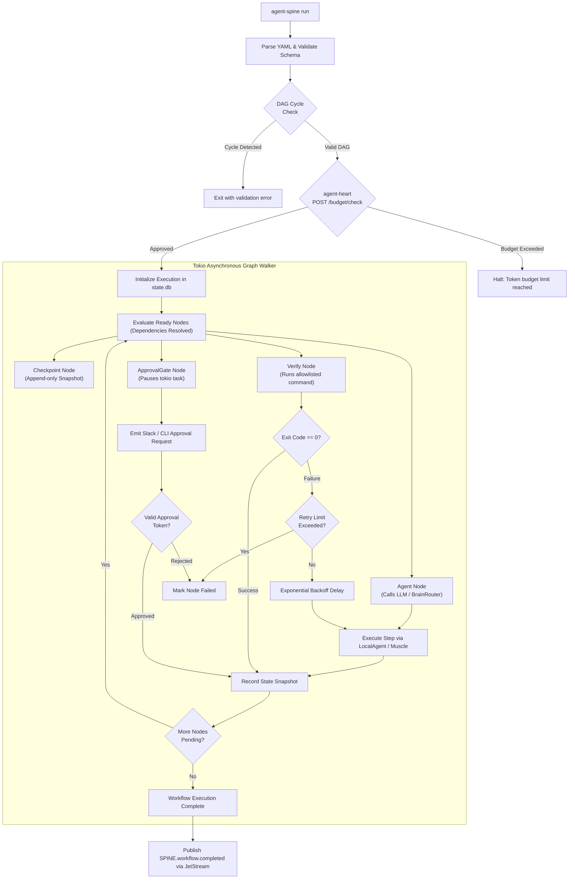

# agent-spine — Deep Operational & Architectural Context for Agents

> **Deterministic Workflow DAG Engine & State Machine** — In-depth architectural guide, execution lifecycle, node taxonomy, complete CLI matrix, MCP tool contracts, and failure recovery runbooks for `agent-spine`.  
> **Ecosystem Version Baseline:** `v1.0.0-beta.3.2`  
> **Documentation Hub:** [https://autonomic-ai.dev/docs/workflows](https://autonomic-ai.dev/docs/workflows) · [Architecture Hub](https://autonomic-ai.dev/docs/architecture)  
> **Ports:** HTTP API `:3001` · Event Bus / Relay `:3100`  
> **Default Workspace & State:** `~/.autonomic/workflows/` · `~/.autonomic/state/spine/state.db`

---

## 1. Executive Summary & Biological Role

In the Autonomic 11-organ architecture, **`agent-spine`** serves as the **Deterministic Workflow Engine and Central Nervous Axis** (analogous to Kubernetes Jobs, Argo Workflows, or Temporal). 

Most AI coding agents fail because they rely on unconstrained, probabilistic prompt loops:
- The agent is asked *"fix bug X"*, and it improvises an unpredictable series of file reads, edits, and terminal commands.
- If step 4 fails, the agent often enters an hallucinatory retry loop, burns hundreds of dollars in tokens, or destroys working code.
- There is no audit trail, no deterministic replay, no coordinated parallelism, and no verifiable human approval gate.

`agent-spine` replaces ad-hoc prompt improvisation with **version-controlled, declarative Directed Acyclic Graphs (DAGs)** written in YAML:
- The graph dictates the control flow, concurrency, checkpoints, and gates.
- The LLM acts strictly as a bounded worker executing isolated tasks *within* designated nodes.
- Every state change is immutably snapshotted to SQLite or JSONL, enabling **time-travel debugging and replayable branches**.

---

## 2. Core Architecture & Node Taxonomy



### 2.1 The Four First-Class Node Kinds (`NodeKind`)

1. **`Agent`**: Represents an isolated cognitive subtask. The step defines input variables, expected output keys, and optional prompt instructions. The executor hydrates required context via `BrainRouter` (querying `agent-brain`), runs the subtask, and collects outputs.
2. **`Checkpoint`**: An explicit synchronization barrier that captures an immutable state snapshot (`Snapshot`). Contains monotonic step index, timestamp, parent snapshot hash, and full environment state.
3. **`Verify`**: Executes an allowlisted validation command (e.g. `cargo check`, `npm test`, `pytest`). Must return exit code 0 to transition to subsequent nodes. Connects with `agent-brain verify` to attribute outcomes.
4. **`ApprovalGate`**: A Human-in-the-Loop (HITL) safety barrier. When the execution reaches this node, the `tokio` worker suspends execution, enters the `PendingApproval` state, and emits events via `agent-nerves` (or webhooks via `agent-mouth`). Execution remains blocked until an authenticated operator submits `agent-spine approve` or the MCP `spine_approve_step` tool is called.

---

## 3. Concurrency, Retries & Snapshot Invariants

### 3.1 Fan-Out / Fan-In Parallelism
`agent-spine` supports declarative parallel execution:
- Nodes with multiple outgoing edges fan out concurrently using `tokio::task::JoinSet`.
- Downstream *Join* nodes automatically pause until all incoming prerequisite edges resolve successfully.

### 3.2 Bounded Exponential Retries
To prevent recursive hallucinatory loops, each node configuration supports an explicit retry block:
```yaml
retry:
  max_attempts: 3
  initial_delay_ms: 1000
  backoff_multiplier: 2.0
  max_delay_ms: 10000
```
If `max_attempts` is exceeded, the node halts, records failure diagnostics, and either aborts the graph or triggers an alternate fallback path if defined in the YAML.

### 3.3 Immutable State Snapshots (Time-Travel Debugging)
Every successful node transition creates an append-only entry in `state.db`. If an agent makes a mistake on step 6:
- The developer can run `agent-spine run workflow.yaml --resume <snapshot-id-step-5>`.
- History is never overwritten. Replay creates a new branched execution path with its own lineage.

---

## 4. Complete CLI Command Reference & Flags

`agent-spine` provides a unified binary for CLI execution, schema validation, template scaffolding, and daemon service:

### 4.1 Workflow Execution & Lifecycle
- `agent-spine run <WORKFLOW.yaml>`: Execute a workflow definition synchronously.
  - `--meta <STRING>`: Attach user task context or descriptive objective to the run.
  - `--var <KEY=VALUE>`: Supply or override input variables for the workflow template (repeatable).
  - `--resume <SNAPSHOT_ID>`: Resume execution from a prior immutable state snapshot.
  - `--dry-run`: Parse, validate graph dependencies, and perform token budget check without executing steps.
  - `--db <PATH>`: Custom path to SQLite state database (default: `~/.autonomic/state/spine/state.db`).
- `agent-spine validate <WORKFLOW.yaml>`: Validate YAML syntax, schema version, node kinds, and ensure DAG is acyclic (no circular dependencies).
- `agent-spine status [<WORKFLOW_ID>]`: Inspect real-time status of running, paused, or completed workflows.
  - `--json`: Output execution metrics, step statuses, and output variables in raw JSON.

### 4.2 Human-in-the-Loop Approval Gates
- `agent-spine approve <WORKFLOW_ID> --step <STEP_NAME>`: Approve a paused `ApprovalGate` node to resume workflow execution.
- `agent-spine reject <WORKFLOW_ID> --step <STEP_NAME> [--reason <STRING>]`: Reject a paused approval gate, halting execution with an error snapshot.

### 4.3 Template Scaffolding & Registry
- `agent-spine init`: Initialize local workflow directory and scaffold default configurations.
  - `--with <@TEMPLATE>`: Scaffold from a curated ecosystem template:
    - `@bugfix`: Reproduce → isolate → fix → verify loop.
    - `@feature-from-spec`: Constitution + spec → plan → implement → test → review.
    - `@mcp-health-check`: Audit schemas → probe gateways → verify route_task.
    - `@release-notes`: Tag diff → changelog synthesis → approval gate.
    - `@stacked-pr`: Rebase stacked branches → resolve conflicts → test suite.
- `agent-spine registry list`: List all available built-in and curated workflow templates.

### 4.4 Daemon & Server Modes
- `agent-spine serve`: Start HTTP REST API server and NATS JetStream event listener.
  - `--port <PORT>`: HTTP API port (default: `3001`).
  - `--relay-port <PORT>`: Dashboard relay port (default: `3100`).
  - `--nats-url <URL>`: NATS broker URL (default: `nats://127.0.0.1:4222`).
- `agent-spine mcp-serve`: Start standalone stdio MCP server exposing workflow orchestration tools directly to an IDE or `agent-body` gateway.

### 4.5 Diagnostics & Brain Integration
- `agent-spine doctor`: Verify rustc toolchain, SQLite database access, NATS JetStream reachability, and agent-brain MCP connectivity.
- `agent-spine brain health`: Probe `agent-brain` stdio MCP server for responsiveness.
- `agent-spine brain route "<TASK>"`: Test task routing and context hydration through `agent-brain`.

---

## 5. Model Context Protocol (MCP) Tool Specifications

When running in MCP mode (`agent-spine mcp-serve` or via `agent-body serve-mcp`), the following tools are exposed:

### 5.1 `spine_submit_workflow`
- **Description:** Submits a declarative YAML workflow for execution. Returns execution ID for tracking.
- **Parameters:**
  - `workflow_yaml` (string, optional): Inline YAML content of the workflow definition.
  - `template_name` (string, optional): Registered template alias (e.g. `@bugfix`, `@release-notes`).
  - `variables` (object, optional): Key-value map of input parameters for the workflow.
  - `metadata` (string, optional): Context string describing the task objective.
- **Return Object:**
  - `workflow_id`: Unique identifier for the spawned execution instance.
  - `status`: Initial status (`running`, `queued`, or `failed`).
  - `initial_snapshot_id`: ID of the baseline snapshot.

### 5.2 `spine_workflow_status`
- **Description:** Queries the current execution state, active steps, outputs, and snapshots of a workflow.
- **Parameters:**
  - `workflow_id` (string, required): The target execution ID.
- **Return Object:**
  - `workflow_id`: Unique execution identifier.
  - `state`: Current state (`running`, `paused_approval`, `completed`, `failed`, `cancelled`).
  - `active_steps`: List of currently executing node names.
  - `completed_steps`: List of finished nodes with their exit codes and output values.
  - `pending_gate`: Details on any active `ApprovalGate` waiting for human input.

### 5.3 `spine_approve_step`
- **Description:** Unblocks a workflow step paused at an `ApprovalGate`.
- **Parameters:**
  - `workflow_id` (string, required): Execution identifier.
  - `step_name` (string, required): Name of the paused gate step.
  - `decision` (string, required): `"approve"` or `"reject"`.
  - `reason` (string, optional): Optional rationale or review feedback.

### 5.4 `spine_cancel_workflow`
- **Description:** Terminates an actively running workflow DAG and marks active steps cancelled.
- **Parameters:**
  - `workflow_id` (string, required): Execution identifier.
  - `reason` (string, optional): Optional reason for cancellation.

---

## 6. Declarative Workflow YAML Specification

Below is an authentic, production-grade example of a workflow definition (`bugfix-pipeline.yaml`):

```yaml
version: 1
name: bugfix_pipeline
description: "Reproduce, isolate, fix, and verify a bug with human sign-off"

inputs:
  issue_id:
    type: string
    description: "Issue or bug ticket identifier"
  test_command:
    type: string
    default: "cargo test"

nodes:
  - id: reproduce_failure
    kind: Verify
    command: "${test_command}"
    description: "Run test suite to verify reproduction of bug"
    continue_on_failure: true

  - id: isolate_and_patch
    kind: Agent
    depends_on: [reproduce_failure]
    prompt: "Analyze test failure in issue ${issue_id}, isolate root cause, and apply minimal patch"
    retry:
      max_attempts: 2
      initial_delay_ms: 1000

  - id: verify_fix
    kind: Verify
    depends_on: [isolate_and_patch]
    command: "${test_command}"
    description: "Confirm all tests pass cleanly after patch"

  - id: human_review
    kind: ApprovalGate
    depends_on: [verify_fix]
    description: "Review git diff and test verification output before final commit"
    timeout_secs: 3600

  - id: commit_and_log
    kind: Agent
    depends_on: [human_review]
    prompt: "Commit changes using conventional commit message and record verification outcome"
```

---

## 7. Cluster Operations & Troubleshooting Runbook

### 7.1 Problem: Workflow Blocked at `ApprovalGate`
- **Symptom:** Workflow status shows `paused_approval` and CLI hangs or agent waits.
- **Resolution:**
  ```bash
  # Check active approval requirements
  agent-spine status <workflow-id>
  # Approve the gate
  agent-spine approve <workflow-id> --step human_review
  ```

### 7.2 Problem: Resume Execution After a Failed Node
- **Symptom:** Workflow aborted at step 3 due to syntax error in generated code.
- **Resolution:**
  ```bash
  # 1. Inspect recent snapshots in state.db
  sqlite3 ~/.autonomic/state/spine/state.db "SELECT id, node_id, status FROM snapshots ORDER BY id DESC LIMIT 5;"
  # 2. Fix the file manually or adjust prompt
  # 3. Resume from snapshot 4 (before the failure)
  agent-spine run bugfix.yaml --resume snap_01J7K...
  ```

### 7.3 Problem: NATS JetStream Disconnected During Workflow
- **Symptom:** Events fail to publish to `SPINE.workflow.>` topics.
- **Resolution:**
  ```bash
  # Verify NATS broker is running
  curl -s http://127.0.0.1:8222/healthz
  # If stopped, restart cluster supervision
  autonomic restart nerves
  ```
