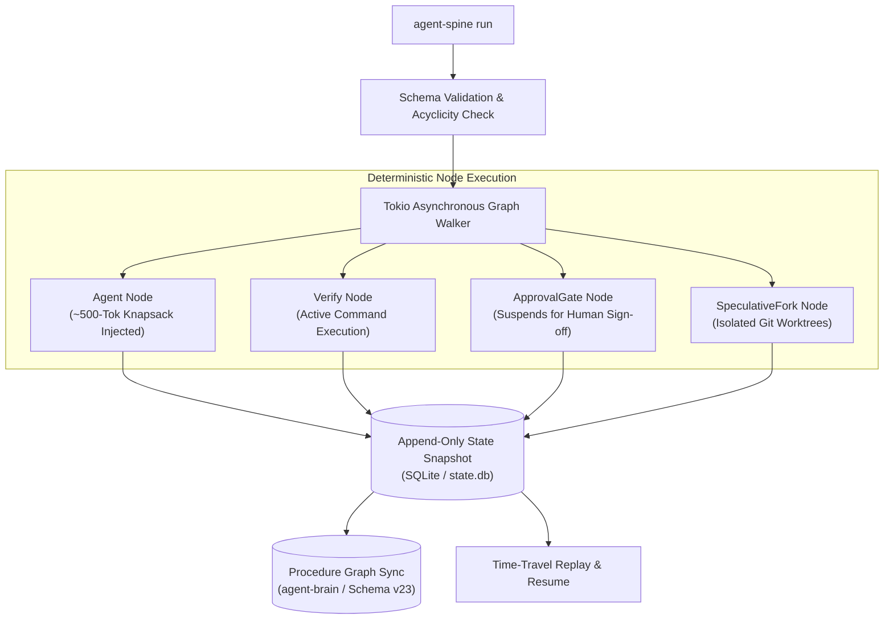

# agent-spine

> **Deterministic Workflow DAG Engine & Cognitive State Machine for Coding Agents.**

[](CHANGELOG.md)
[](LICENSE)
[](https://autonomic-ai.dev)
[](https://autonomic-ai.dev)

Part of [Autonomic AI](https://autonomic-ai.dev), alongside [agent-brain](https://github.com/autonomic-ai-dev/agent-brain). Replaces probabilistic agent prompt loops with **declarative, version-controlled Directed Acyclic Graphs (DAGs)**, immutable snapshots, and human-in-the-loop gates.

---

## Architectural Overview



---

## Why agent-spine?

| Challenge in Agentic Automation | agent-spine Solution | Mechanism |
| :--- | :--- | :--- |
| **Unbounded Agent Retries & Token Burns** | Strict DAG execution bounds worker tasks to isolated steps with retry policies | Exponential backoff, circuit breakers, and critical-path scheduling |
| **Hallucinatory Control Flow** | Declarative YAML topology dictates transitions and branching conditions | Acyclic graph validator with boolean condition expressions |
| **Silent Failures & Missing Evidence** | `Verify` nodes actively execute shell validation commands under timeouts | Captures exit codes, stdout/stderr, and fails closed |
| **Context Window Pollution** | Each node is injected with a surgical cognitive knapsack from `agent-brain` | Node-specific `_brain_knapsack` with token budgeting |
| **Disaster Recovery Amnesia** | Immutable state snapshots recorded at every step transition | `--resume <seq>` CLI and 1-click dashboard replay |
| **Flaky or Speculative Refactors** | Parallel speculative worktree branching | Evaluates multiple git branches concurrently, merging winning verified path |

---

## Node Kinds (`NodeKind`)

| Kind | Purpose | Behavior |
| :--- | :--- | :--- |
| **`Agent`** | Discrete cognitive task | Hydrates ~500-token knapsack via `agent-brain route_task`, delegates to worker, snapshots result |
| **`Verify`** | Machine validation | Actively executes `command`, captures exit code and output, sets `verified` status |
| **`ApprovalGate`** | Human-in-the-loop barrier | Suspends execution and awaits operator `agent-spine approve` or dashboard action |
| **`SpeculativeFork`** | Competitive multi-branching | Spawns isolated Git worktrees to evaluate multiple solutions concurrently |
| **`Fork` / `Join`** | Concurrency barrier | Fans out across parallel branches, joining when all prerequisites resolve |
| **`Debate`** | Multi-agent refinement | Alternates between coder and critic agents in iterative rounds |
| **`Vote`** | Consensus selection | Runs prompt N times with temperature variance, selecting best output |
| **`Router`** | Dynamic branch decision | Injects variables into payload to evaluate conditional edges |
| **`Hydrate`** | Context gathering | Collects environment diagnostics (diffs, logs) before agent execution |
| **`Checkpoint`** | Audit synchronization | Appends immutable point-in-time state snapshot |

---

## Quickstart & Installation

### Option 1: Homebrew (macOS — Recommended)

```bash
brew tap autonomic-ai-dev/tap
brew install agent-spine
agent-spine init
```

### Option 2: Direct Download / Curl

```bash
curl -fsSL https://raw.githubusercontent.com/autonomic-ai-dev/agent-spine/master/scripts/install.sh | bash -s -- --global
```

### Option 3: Compile From Source (Rust)

```bash
git clone https://github.com/autonomic-ai-dev/agent-spine.git
cd agent-spine
cargo build --release -p agent-spine
./target/release/agent-spine doctor
```

---

## Core Commands

| Command | Purpose |
| :--- | :--- |
| `agent-spine init` | Scaffolds `.autonomic/workflows/` and starter templates |
| `agent-spine validate <file>` | Validates DAG syntax, node types, and acyclicity |
| `agent-spine run <file>` | Executes a workflow DAG synchronously |
| `agent-spine run <file> --resume <seq>` | Time-travel resume from a previous state snapshot |
| `agent-spine status [<id>]` | Real-time status of active or completed runs |
| `agent-spine approve <id> --step <name>` | Unblocks a paused `ApprovalGate` node |
| `agent-spine reject <id> --step <name>` | Rejects an approval gate, halting execution safely |
| `agent-spine serve` | Starts HTTP API server and Svelte dashboard on `:3100` |
| `agent-spine mcp-serve` | Starts stdio MCP server for Cursor, Claude, AGY |
| `agent-spine doctor` | Checks toolchain, SQLite storage, and `agent-brain` bridge |

---

## Declarative Workflow Example

```yaml
version: 1
name: bugfix_pipeline
description: "Reproduce, isolate, fix, and verify a bug with human sign-off"

nodes:
  - id: reproduce_failure
    kind: verify
    command: "cargo test --test reproduce_bug"
    continue_on_failure: true

  - id: isolate_and_patch
    kind: agent
    depends_on: [reproduce_failure]
    description: "Analyze test failure, isolate root cause, and apply minimal patch"
    retry:
      max_attempts: 2
      backoff_ms: 1000

  - id: verify_fix
    kind: verify
    depends_on: [isolate_and_patch]
    command: "cargo test --all-features"

  - id: sign_off
    kind: approval_gate
    depends_on: [verify_fix]
    description: "Operator sign-off before committing changes"
```

---

## Verification & Development

```bash
# Formatter & linter check
cargo fmt --all -- --check
cargo clippy -p agent-spine -- -D warnings

# Run all test suites
cargo test -p agent-spine

# Run workflow engine verification playbook
.verify/playbooks/verify_workflow_engine.sh
```

---

## Ecosystem & Documentation

- **Documentation Portal**: [https://autonomic-ai.dev](https://autonomic-ai.dev)
- **Workflow & DAG Architecture**: [https://autonomic-ai.dev/docs/workflows](https://autonomic-ai.dev/docs/workflows)
- **Ecosystem Architecture Guide**: [https://autonomic-ai.dev/docs/architecture](https://autonomic-ai.dev/docs/architecture)
- **Cognitive Governor (`agent-brain`)**: [https://github.com/autonomic-ai-dev/agent-brain](https://github.com/autonomic-ai-dev/agent-brain)

---

## License

Apache-2.0 © [Autonomic AI](https://github.com/autonomic-ai-dev) · See [CHANGELOG.md](CHANGELOG.md) for release history.
